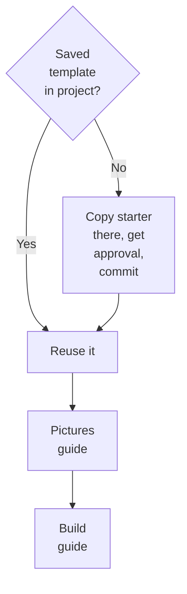

# Client Report

Output = one PDF for a client: what is live, what changed, what is left, who must answer what.

## Routes

## Core rules

- The approved report's HTML + CSS live in the project at `docs/client-report/template.html`, tracked. A context reset loses nothing. Copy it for each report and change text only. Never rebuild from Markdown tables or a generic page.
- No template yet → copy [the starter](assets/starter.html) there, show the user the first report, commit it only after they approve it.
- No codes (A1, C2). Write each item in full. Write each question in full, grouped by who must answer, each with "Why we ask" and "Until you answer, we ..." lines.
- Pictures come from the live deployed app, signed in as each role, read only. Test-copy pictures only when the user asks.
- Before sending: `python3 <skill>/scripts/check_report.py <report.html>` passes, then you look at every page image ([build](references/build.md)). A page not looked at = a report not sent.
