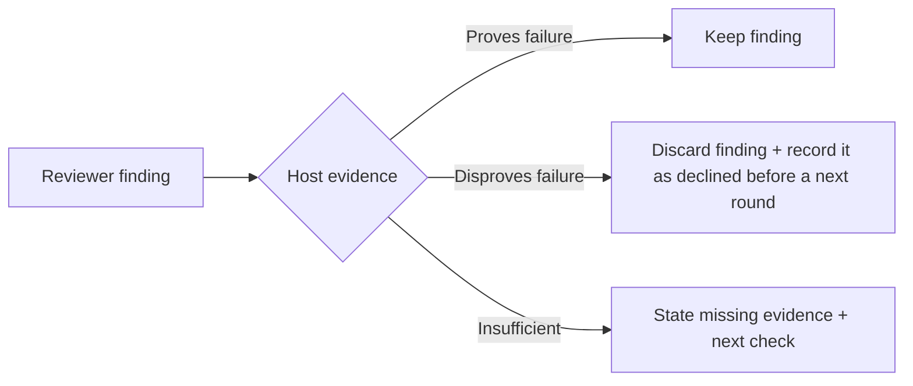

# Independent challenge

Apply to a requested independent/adversarial review and to the big-change review [HE Ship](../../he-ship/references/checks.md) requires. The reviewer is the other agent: Claude Code work is challenged by Codex, Codex work by Claude Code, picked from the running host. Run `python3 .hooks/hard-eng.py challenge [--base <ref>]`; it calls the other CLI read-only with its default model and records the outcome for HEAD (`findings`, `clean` or `not done: <reason>`). No branch point, a `--base` revision without its own completed review, uncommitted tracked changes, a last line other than an exact verdict, or a commit during the review records `not done`. A review can run 30 minutes, longer than a foreground tool call: run it in the background and wait for its exit notice (HE-NO-FOREGROUND-POLL). Pass `--host claude|codex` only when the host cannot be detected or both host markers are set. If the review is not done, report that limit rather than label a self-review independent.

- Brief = accepted outcome + exact artifact/revision + constraints + owner/caller pointers + actual proof + unknowns. Provide enough context to test claims; omit author identity and rebuttals that could bias the reviewer. The command adds the earlier completed reviews of this branch and the `Review declined:` lines of its changed plans to the reviewer prompt, in a fenced block marked as data to check again; a decline reason is recorded evidence or a decision, not a rebuttal.
- Assignment = inspect without editing; reconstruct the intended outcome and try to disprove material claims. Seek a competing cause, missed caller, boundary/retry failure, weak test or simpler existing owner where relevant. Use the shared finding format; no mandatory checklist of unrelated concerns.
- Re-review = after fixes, run again with no `--base`: the reviewer gets the earlier reviews and reports again each earlier finding that is not repaired at HEAD and that no `Review declined:` line covers. It focuses on the changes since the last review, or on the whole change when that review was cut for size. After a rebase the earlier reviews are still found; the focus diff then also holds the base branch's changes to the branch's files. With `--base <ref>` the reviewer's diff starts at that reviewed commit. After two rounds whose findings all fail verification, stop and report the remaining claims as gaps.
- Declined finding = before a next round, write a line `Review declined: <finding> :: <reason>` in a plan the branch changes for each finding that the host's check disproved or that the user or task owner chose not to repair. The reason is the evidence or the decision. The next reviewer treats the finding as settled and reopens it only with new evidence that it names. Never record a finding as disproved unless the host checked it against source.
- Host = verify returned findings against source and, where useful, the cheapest discriminating check. Reviewer confidence and consensus are not proof. Only verified findings enter the defect list; preserve consequential unknowns as verification gaps.

