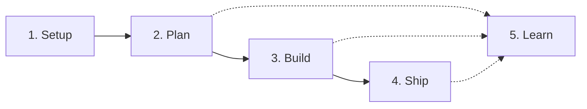
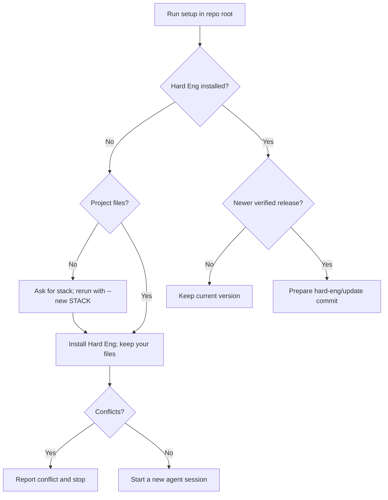
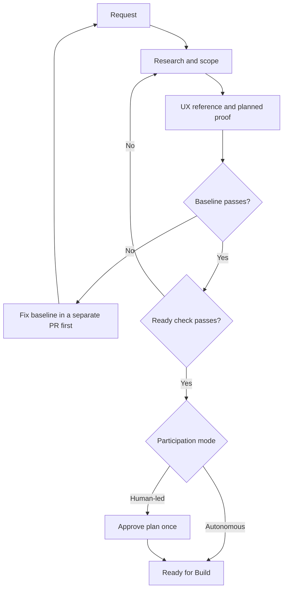
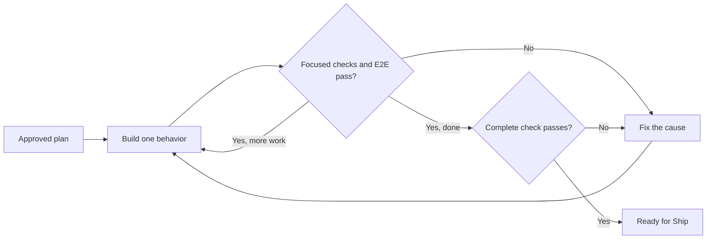
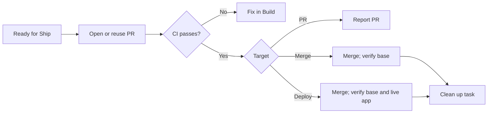
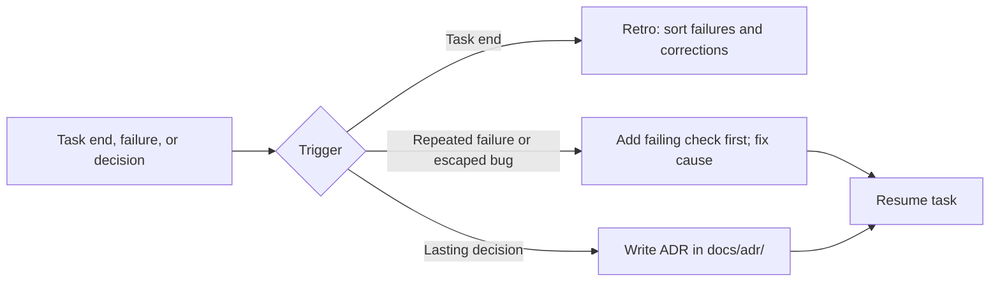
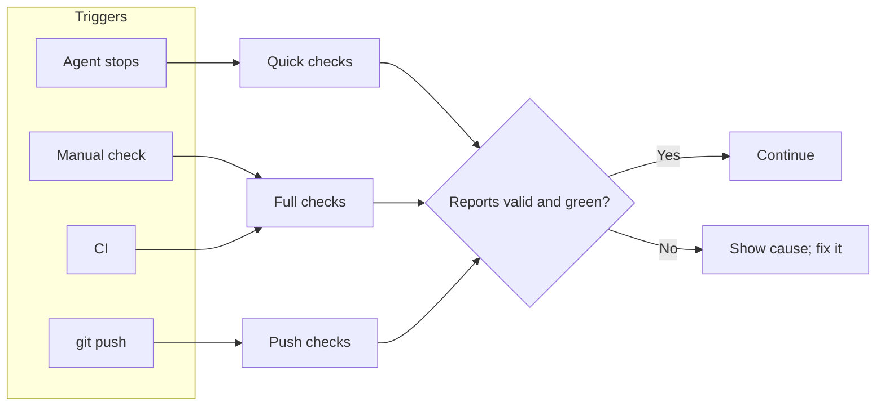

# Hard Eng

**A strict workflow for one developer building with coding agents.**

Hard Eng installs skills, hooks, and automated checks into your repository. Your agent (**Claude Code**, **Codex**, or **Antigravity**) then takes each task through four stages. A fifth stage, **Learn**, runs a retro at the end of each task, and also runs when a failure repeats, a bug is found on the base branch, or a decision must last.



> **Alpha.** Some hooks and checks still have limits. See [verified behavior and open gaps](DECISION.md#current-status).

[Quick start](#1-setup) · [Workflow](#2-plan) · [Checks](#checks) · [Rules and enforcement](#rules-and-enforcement) · [Security](#security)

## Why Hard Eng is strict

Hard Eng refuses bad code instead of printing ignorable warnings.

- **Checks cover existing code.** The full `check` scans every tracked file and every non-ignored new file, not only your new lines. Quick checks when an agent stops inspect only this session's changes.
- **No switch-offs.** Ignore comments, skipped or focused tests, test retries, and disabled rules fail, even old ones. Generated output and Hard Eng's own folders (`.hooks/`, `.agents/`, `.claude/`) are exempt.
- **Fix the cause.** Each failure names the fix. For example, a wait with no delay, or a wait for the next frame, fails in app code. The fix is to change the order of events.
- **No leftover notes.** `TODO`, `FIXME`, `HACK`, and `XXX` in comments fail (strings pass). Multi-line comment blocks fail. Comment rules skip generated output and `.agents/` only. Unreferenced Markdown files fail; standard files such as `README.md` and `AGENTS.md`, and Hard Eng's installed folders, pass.
- **Existing debt can only shrink.** Findings from the strict rules above never enter the debt record; fix them first. Other checks can record pre-existing findings once during adoption in `hard-eng.debt.json`. After that, entries may only be removed ([HE-DEBT-SHRINK-ONLY](.agents/skills/he/references/requirements.md#he-debt-shrink-only)).

## 1. Setup

Run this command in the root of your Git repository:

```sh
curl -fsSL https://raw.githubusercontent.com/sgaabdu4/hard-eng/main/setup.sh | sh
```

### Start a new project

In an empty repository, pass `--new` and a stack:

```sh
curl -fsSL https://raw.githubusercontent.com/sgaabdu4/hard-eng/main/setup.sh | sh -s -- --new vite
```

| Stack | What you get |
| --- | --- |
| `vite` | React + Vite single-page app with Bun. |
| `nextjs` | Next.js app (App Router, Tailwind) with Bun. |
| `opennext` | Next.js on Cloudflare Workers through OpenNext, with Bun. |
| `flutter` | Flutter app with Riverpod, code generation, and localization. |
| `python` | Python app with uv. |

### What setup does

| Repository state | What setup does |
| --- | --- |
| Empty | Stops and asks for `--new STACK`. |
| Python, JS/TS, or Dart/Flutter | Installs rules, skills, hooks, and checks. Preserves your own files and reports real conflicts. |
| Other languages (Go, Rust, Java/Kotlin, Ruby, PHP, .NET, Swift outside a Flutter app, C/C++, shell) | Basic mode: rules, skills, hooks, CI, secret scans, Semgrep, and OSV (when a lockfile exists). Prints `Gap:` lines so the agent files missing checks with `gap-issue`. |
| Hard Eng already installed | Prepares a one-commit update branch when a newer CI-verified release exists. |

In every installed repository, setup also:

- Adds shared rules to the top of `AGENTS.md` (read natively by Codex, Antigravity, and Claude Code v2.1.277+).
- Connects Appwrite, Sentry, Dart, and Marionette when the project uses them. Every Flutter app gets Marionette, pinned to the `marionette_flutter` version in `pubspec.lock`.
- Copies compatible custom MCP servers from `.mcp.json` and `.codex/config.toml` into `.agents/mcp_config.json` for Antigravity, while keeping existing non-retired entries in `.agents/mcp_config.json` untouched.
- Installs the Appwrite skill when the project uses Appwrite, and the Flutter skill when it uses Dart. Installs the [Trello coordinator](.agents/skills/trello-coordinator/SKILL.md) skill only when `trello.json` sits at the repository root.
- Never pushes to a remote.

After setup:

- Start a new agent session so it loads the new skills and MCP config.
- `git push` stays refused until `hard-eng.gates.json` defines `shipping` ([shipping setup](.agents/skills/he-ship/references/checks.md)).

### Agent host setup

| Agent | What to know after setup |
| --- | --- |
| **Claude Code** | Setup writes `.mcp.json` and approves detected servers in `.claude/settings.json`. Trust the main repository folder so worktrees inherit approvals. |
| **Codex** | Start Codex, trust the project, and review hooks with `/hooks` (re-review when hooks change). `--yolo` does not set up hooks ([Codex hook trust](https://learn.chatgpt.com/docs/hooks#review-and-trust-hooks)). |
| **Antigravity** | Setup writes `.agents/hooks.json` and `.agents/mcp_config.json` (omitting Claude's `"type"` field from server entries). It keeps existing non-retired entries in `.agents/mcp_config.json` untouched and copies compatible custom servers from `.mcp.json` and `.codex/config.toml`. Antigravity starts loading workspace MCP servers in the background when a session opens. A newly added server needs a new session to load, and a newly opened session may need a follow-up turn before those tools appear. |

### Requirements

| Tool | Notes |
| --- | --- |
| Git, `curl`, `uv`, Bun, Python 3.12 or later | Bun installs check tools on every stack. |
| Stack SDK | Flutter for Dart; Xcode on macOS for Swift in Flutter apps. |
| GitHub CLI (`gh`) | Required by `update-pr`, `ship`, and `gap-issue`. |
| `npm` 11.16 or later | Required by Dart Decimate. |

<details>
<summary>More setup details: --new steps, web stack choice, CLAUDE.md cleanup, and automatic updates</summary>

#### What `--new` does
1. Runs the stack's official scaffold tool (`vite`, `nextjs`, `opennext` at pinned versions; Flutter and `uv` at installed versions).
2. Adds starter tests, a performance test, and architecture boundary rules so checks pass immediately.
3. Replaces other JS linters with Biome.
4. Pins every package (web stacks pick the newest release at least two days old; Flutter uses pub; Python uses `uv lock`).
5. Commits the scaffold, then installs Hard Eng. You or your agent still write `PRODUCT.md` and `DESIGN.md`.

#### Choosing a web stack
The agent asks you instead of picking Next.js by default:
- **Next.js:** Public pages needing SEO or fast first load, or one repo for pages and server code.
- **React + Vite:** Apps behind a login, internal tools, or apps with a separate backend.

#### `CLAUDE.md` cleanup
Setup removes Claude instruction files that only import or link to `AGENTS.md`. It stops on any other `CLAUDE.md` or `CLAUDE.local.md`, including parent or subfolder files. Then do this:

1. Move shared rules into `AGENTS.md`.
2. Move private rules outside the repository (for example `~/.claude/CLAUDE.md`).
3. Remove the file.

#### How updates work
- At session start, a hook reports the last update result and starts the next update in the background, so a session never waits. It writes `.hard-eng/update.log`. When it finishes, it also tidies idle merged branches (unused for 24 hours) and idle Rust build folders, skipping anything with a stash, open PR, or running process.
- The update builds in a separate worktree checked out from the remote base branch. It leaves one commit on local branch `hard-eng/update` and never touches your current branch.
- Run `python3 .hooks/hard-eng.py update-pr` to push `hard-eng/update` and open or reuse the "Update Hard Eng" PR. It merges the PR only after every check passes; rerun it to merge once pending checks finish. Pass `--no-merge` to print the merge command instead. Before pushing, `update-pr` load-tests the update branch's gate and debt files under the new hooks.
- Updates read only files tracked on the remote base branch and stop if an update would overwrite an untracked or ignored local file.
- A refused update never weakens checks. The agent fixes the cause in its own commit, merges that fix into the base branch through a PR, and reruns setup. When a local file blocks the update, move it aside and rerun setup.



</details>

Details: [entry command](setup.sh), [installer](setup.py), [new projects](new_project.py), [integrations](.agents/skills/he/references/integrations.md).

## 2. Plan

You do not need to invoke skills by name; the `he` skill routes each stage automatically.

Each non-trivial task uses one `PLAN.md` holding the scope, decisions, planned proof, and verified outcome. A small change needs no plan. `check` compares the whole branch with its merge base on the default branch and prints `Size: small` or `Size: big, because ...`. After `Size: big` with no plan, `check` stops and runs no gate. An existing `PLAN.md` is always validated, even on a small change.

A change is **small** when it is documentation-only, or when all of these hold:

- At most 20 changed lines across at most 3 non-doc files.
- No added, deleted, renamed, or binary files.
- No edits to dependencies, CI, `.hooks/`, `.agents/`, `.claude/`, `hard-eng.gates.json`, `AGENTS.md`, or databases.
- No removed test lines. Empty lines and import lines that name no test do not count.

[HE Plan](.agents/skills/he-plan/SKILL.md) runs five steps:

1. **Research:** Inspect the codebase and verify current facts at the source.
2. **Scope:** Define the outcome and non-goals; ask only decisions that change the result.
3. **UX:** Show a mock or real-app preview for visible changes. Changes to existing screens require real-app before/after captures ([HE-REAL-APP-PREVIEW](.agents/skills/he/references/requirements.md#he-real-app-preview)).
4. **E2E:** Name the user journey and expected proof (or why none applies).
5. **Readiness:** Pass the Draft baseline check, then the Ready check.



You pick the participation mode once: **Human-led** asks for one plan approval before building; **Autonomous** proceeds within the permission you already gave. For complex work with many coupled unknowns, [Wayfinder](.agents/skills/he-plan/references/wayfinding.md) splits planning into small research and decision tickets first.

<details>
<summary>Required plan fields validated by check</summary>

`check` validates the format of these fields on new and edited plans. An unchanged historical Complete plan is not held to newer fields.

| Field | What it records |
| --- | --- |
| `Sources:` and rows | Every user-supplied source plus one row per role, screen, rule, and outcome ([HE-SOURCE-COVERAGE](.agents/skills/he/references/requirements.md#he-source-coverage)). Multiple or large sources get an independent reader pass. |
| `Same cause:` | Earlier fixes of the same cause and every other place the bug can occur. |
| `Single source:` | The single owner of each rule, constant, value, or type touched. |
| `Real service:` | One real run per changed call to an outside service ([HE-REAL-SERVICE-RUN](.agents/skills/he/references/requirements.md#he-real-service-run)). The run uses a test account, sandbox, or staging project and test records only. It also triggers one refusal for each refusal the code tells apart by its error. |
| `Retro:` | Prevention recorded for each failed check and review/user correction in the task. |

</details>

Related skills: [Research](.agents/skills/research/SKILL.md), [Codebase Design](.agents/skills/codebase-design/SKILL.md), [UX guidance](.agents/skills/he-plan/references/ux.md).

## 3. Build

[HE Build](.agents/skills/he-build/SKILL.md) carries out the approved plan on a task branch, one complete behavior at a time. After each behavior, it runs focused checks, [reviews the diff](.agents/skills/code-review/SKILL.md), and runs the planned [E2E](.agents/skills/e2e/SKILL.md) journey. When all behaviors finish, it runs the integrated Complete check.



The agent records the real proof in `PLAN.md`, then marks it Complete. Only E2E proof that needs a live deployment may stay pending until Ship.

## 4. Ship

[HE Ship](.agents/skills/he-ship/SKILL.md) delivers only up to the target you authorized: **PR**, **Merge**, or **Deploy**.



Before shipping a PR, Hard Eng checks:

- **Adversarial review (big changes):** `python3 .hooks/hard-eng.py challenge` runs another agent CLI read-only against the diff. Claude Code falls back through Codex then Antigravity; Codex through Claude Code then Antigravity; Antigravity through Codex then Claude Code. When no reviewer can run or finish, the PR still ships and states that the review was not done.
- **PR text quality:** Requires an `Undo:` line, a `Not checked:` line, two or more Mermaid diagrams showing the states before and after, and concise text (at most 6,000 visible characters and no visible line over 600; put long details in `<details>`).
- **UI evidence and privacy:** Visual changes include inspected before and after captures only when appearance changed. The agent checks outgoing text for secrets, personal data, and private project details.
- **Clean rebase merge:** `ship` refuses branches behind base, refuses squash merges, and merges via rebase on the exact verified head commit (release PRs use a merge commit). Before merging, `ship` also blocks when the installed Hard Eng is out of date or its version cannot be confirmed. Cleanup runs only after merge is confirmed.
- **Commit cap:** A PR holds at most 100 commits ([HE-PR-COMMITS](.agents/skills/he/references/requirements.md#he-pr-commits)), and each `check` except `--quick` warns from 80. The cap skips the Hard Eng update PR and PRs into branches other than the shipping base.

## 5. Learn

[HE Learn](.agents/skills/he-learn/SKILL.md) runs a retro at the end of each task. It also runs when a failure repeats, a bug is found on the base branch, or a decision must last.



- **Checks beat instructions:** Prefer a test, lint, or hook over new prose; change a skill only when deterministic checks cannot catch the failure.
- **Repeat tracking:** The Stop hook records failures in `.hard-eng/failures.json` and flags repeats across edits.
- **Scoped ADRs:** Each record in `docs/adr/` declares `Applies to:` path prefixes so the Stop hook surfaces it when matching files change ([HE-ADR-SCOPE](.agents/skills/he/references/requirements.md#he-adr-scope)).

## Checks

Each repository configures its checks, reports, package graph, and time budgets in `hard-eng.gates.json`. Hard Eng detects supported packages automatically (monorepos included) and inspects every tool's structured report, not just exit codes.

### Language checks

| Stack | Required checks | Tools | Extra checks when applicable |
| --- | --- | --- | --- |
| **Python** | Format, lint, complexity, strict types, annotations, tests + coverage, dead code, duplicates, dependencies, performance. | Ruff, Pyrefly, Pytest, Vulture, jscpd, Deptry. | Import Linter (when import roots exist). |
| **JS / TS** | Format & lint, focused-test check, types, typing style, tests + coverage, dead code + `.fallowrc.json` boundaries, duplicates, performance. | Biome, TypeScript, project test runner, Fallow. Zod is the suggested validator. | React Doctor for React; existing `build`, UI, integration, generated, boundary, and `check:fallow` scripts. |
| **Dart / Flutter** | Format, analyzer, tests + coverage, dead code, duplicates, architecture boundaries, performance. | Dart format/analyzer/test, Dart Decimate. | A boundary rule needs real project prefixes; app builds and device proof stay project tasks. |
| **Swift in Flutter (`ios/`, `macos/`)** | Format & lint, Xcode build + tests + coverage, duplicates, Semgrep, reviewed `performance_exception`. | `swift format`, `xcodebuild`, `xcresulttool`/`xccov`, jscpd, Semgrep. | CocoaPods (`pod install --deployment`). Applies only to Swift beyond the starter files `flutter create` writes; plain SwiftPM/Xcode stays in basic mode. |

### Shared checks

| Present in repo | Shared check |
| --- | --- |
| Any supported code | Gitleaks (working tree + Git history, unless history scan is disabled) and Semgrep security scan. |
| GitHub workflows | Actionlint and Zizmor. |
| Shell scripts | ShellCheck. |
| Deploy configs | Deployment config scan (such as Trivy). |
| Lockfiles | OSV vulnerability scan. |

Checks run only for affected packages, their known dependents, and shared checks. Pre-push leaves dependents to CI. A push that lands one merged PR reuses that PR's passed checks when the tree is the same. A release PR from the base branch into another branch reuses its head commit's passed checks the same way. Inspect CI minutes with `python3 .hooks/hard-eng.py ci-usage [--runs 150]`.

<details>
<summary>Advanced check details: CI runners, Swift jobs, Bun/mise caches, quick Dart analysis, mutation reports, and worktrees</summary>

- **What enforces merges:** Local clones have no pre-push hook until setup runs, and `--no-verify` bypasses local hooks. Require the `hard-eng` status check on your base branch in GitHub rulesets.
- **Self-hosted runners:** Generated workflows default to `ubuntu-latest` (and `macos-latest` for Swift groups). Private repos may set repository variables `CI_RUNS_ON` or `CI_MACOS_RUNS_ON` (JSON `runs-on` value). Keep both unset in public repos so outside PRs cannot run on private runners.
- **Swift job split:** Flutter repos with Swift beyond the starter files `flutter create` writes get `hard-eng-linux`, `hard-eng-apple` (runs only when a Swift group is affected), and an aggregator `hard-eng` check.
- **Bun and tool caches:** Workflows pin Bun (project pin → newest release ≥2 days old → `latest`) and reuse pre-exported `MISE_DATA_DIR`, `MISE_CACHE_DIR`, `MISE_STATE_DIR`, or `BUN_INSTALL_CACHE_DIR` variables when set.
- **Quick checks and Dart analysis:** Stop-hook quick checks run format, lint, types, and the current-files secret scan. They also run a package's install command and `generated` check until both pass in this checkout, and again when a lockfile changes or an install folder is added or removed. For Dart, quick check runs `dart analyze --fatal-infos` on changed Dart files first (only the full check catches unchanged files broken by a change). Findings or a deleted Dart file escalate to the whole package, and `.yaml`, `.lock`, or `.arb` edits analyze the whole package directly.
- **Mutation reports:** After pre-push checks pass, a report-only mutation pass flags changed lines whose tests miss small injected faults (default budget `pre_push_mutation_seconds`: 120 s). Run anytime with `python3 .hooks/hard-eng.py mutation`.
- **New worktrees:** The worktree hook symlinks ignored `.env*` files, `.claude/settings.local.json`, and `CLAUDE.local.md` without copying contents, copies ignored hooks folders (like Husky), and initializes submodules.

</details>

More detail: [gates](.agents/skills/he/references/gates.md), [testing](.agents/skills/he/references/testing.md), [shipping](.agents/skills/he-ship/references/checks.md), [this repo's gate file](hard-eng.gates.json), or run `python3 .hooks/hard-eng.py --help`.

## Rules and enforcement

Skills guide the agent; hooks and checks enforce what machines can verify. Plan checks validate required fields and declared results. They cannot prove that a screenshot is real, judge design quality, or prove that the agent followed every instruction. Hooks require host support and project trust.

| Trigger | What runs |
| --- | --- |
| **Session start** | Reports last update result and starts the next background update plus idle branch and Rust build cleanup. |
| **Shell tool (Claude / Antigravity)** | Blocks main-session foreground sleep polling ([HE-NO-FOREGROUND-POLL](.agents/skills/he/references/requirements.md#he-no-foreground-poll)) and unguarded `gh pr merge`. |
| **Agent stops** | Validates plan handoff and runs quick checks on this session's changes. |
| **`git push`** | Checks pushed commits in a separate worktree for the changed packages (related tests only with Vitest or Jest), then gives a mutation report. When `pre_push_checks` is `"ci"`, direct pushes to base and secret scans still run locally while the full check moves to CI. |
| **`git worktree add`** | Links local ignored env and settings files, copies ignored hooks, and initializes submodules. |
| **CI** | Runs checks for affected packages, dependents, and shared scans; fails on any violation. |



### Rule quick reference

Full canonical definitions live in the [requirement registry](.agents/skills/he/references/requirements.md). Fill in [PRODUCT.md](PRODUCT.md) and [DESIGN.md](DESIGN.md) for your project.

| Rule | Short meaning | Enforced by |
| --- | --- | --- |
| [HE-COVERAGE-MIN](.agents/skills/he/references/requirements.md#he-coverage-min) | Tests cover at least 70% of lines. | Check |
| [HE-PERFORMANCE-SUITE](.agents/skills/he/references/requirements.md#he-performance-suite) | Package has a performance suite or reviewed exception. | Check |
| [HE-UNTRUSTED-JSON](.agents/skills/he/references/requirements.md#he-untrusted-json) | Parsed JSON stays `unknown` until validated (no casts except `as const`). | Check |
| [HE-FILE-LENGTH](.agents/skills/he/references/requirements.md#he-file-length) | Files over 1,000 lines need a reviewed exception. | Check |
| [HE-HOT-PATH](.agents/skills/he/references/requirements.md#he-hot-path) | Known slow patterns fail the security gate; `python3 .hooks/hard-eng.py hot-paths` lists them. | Check |
| [HE-NO-SWITCH-OFF](.agents/skills/he/references/requirements.md#he-no-switch-off) | No lint, type, or scanner suppressions, skipped or focused tests, test retries, or net loss of assertions. | Check |
| [HE-COMMENT-LINES](.agents/skills/he/references/requirements.md#he-comment-lines) | No multi-line comment blocks or `TODO`/`FIXME`/`HACK`/`XXX` comments, including old ones. Generated output and `.agents/` are exempt. | Check |
| [HE-DEBT-SHRINK-ONLY](.agents/skills/he/references/requirements.md#he-debt-shrink-only) | `hard-eng.debt.json` is recorded once at adoption and may only shrink. | Check |
| [HE-UI-SOURCE](.agents/skills/he/references/requirements.md#he-ui-source) | Added UI lines hold no `transition` on all properties and none of the listed color literals outside a theme or token file. | Check |
| [HE-NO-TEXT-WALLS](.agents/skills/he/references/requirements.md#he-no-text-walls) | On-screen text stays in short blocks: at most 25 words and 3 sentences per block, and at most 20 words per sentence. `python3 .hooks/hard-eng.py text-walls` lists the hits. | Check |
| [HE-SEND-LIMIT](.agents/skills/he/references/requirements.md#he-send-limit) | Code that runs with no person present and can send sets a maximum number of sends per period. A send that answers one outside event can use one send for each event ID. | Guidance, applied in review |
| [HE-OUTPUT-PLAIN](.agents/skills/he/references/requirements.md#he-output-plain) | Text for people is plain, simplified technical English. | Guidance |
| [HE-YAGNI](.agents/skills/he/references/requirements.md#he-yagni) | Add a file, dependency, abstraction, setting, or stored state only for a current agreed requirement when existing code or a direct command is not enough. | Guidance |

## Security

- Semgrep scans source code; OSV scans lockfiles and images.
- Scanners only cover what they inspect; they never replace server-side authorization or rotating leaked secrets.
- [Security Review](.agents/skills/security-review/SKILL.md) audits trust-boundary changes (auth, permissions, keys, payments, uploads, personal data).
- Passing checks and skills never grant permission to publish, spend money, or change access.

## Read next

- [Product intent and boundaries](PRODUCT.md)
- [Technical component overview](DESIGN.md)
- [Current verification, decisions, and acceptance gaps](DECISION.md#current-status)
- [Research guidance](.agents/skills/research/SKILL.md)
