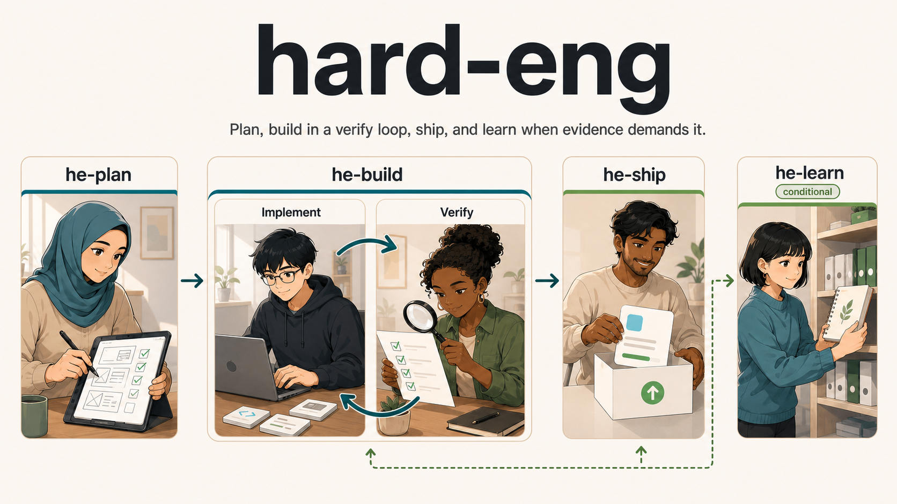
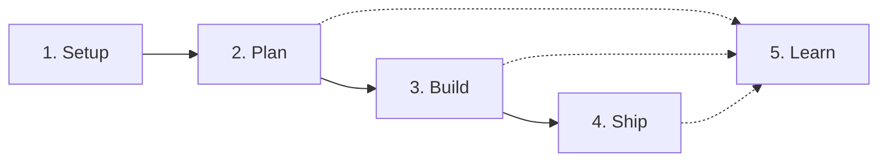
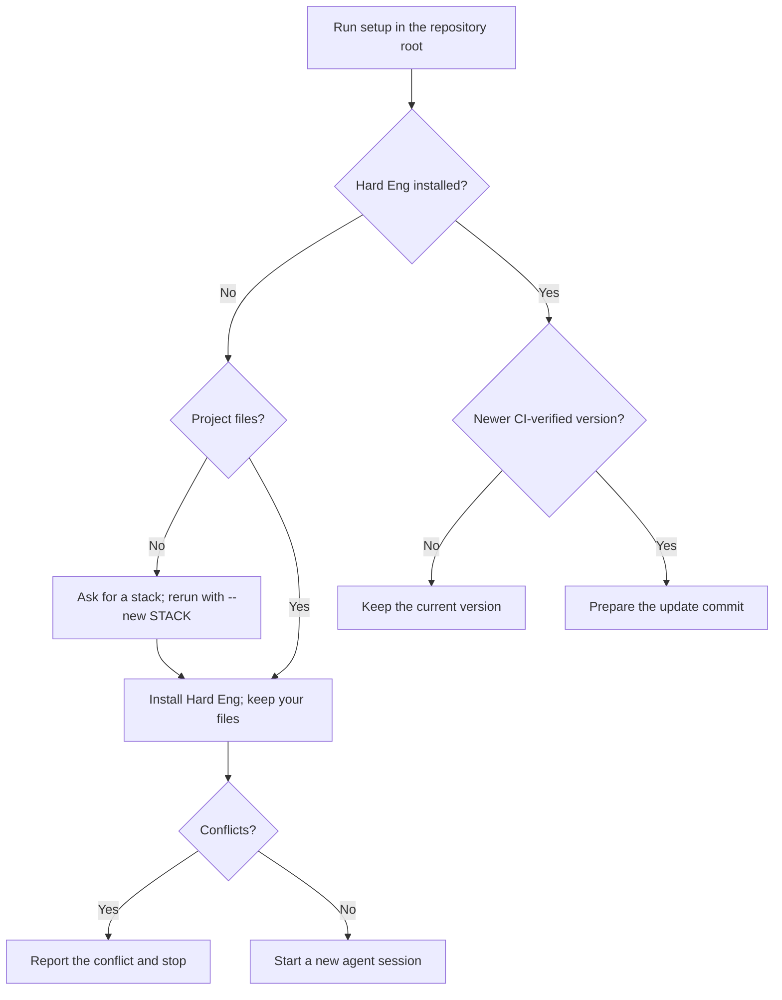
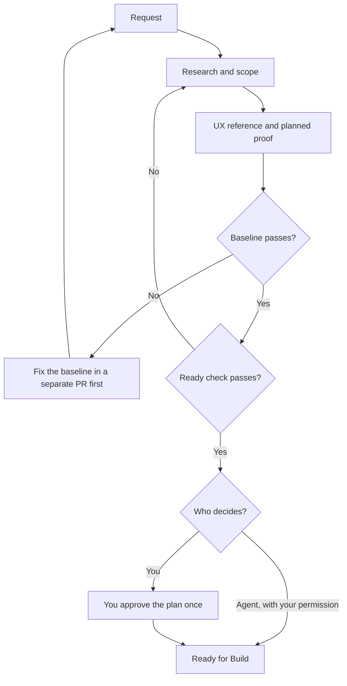
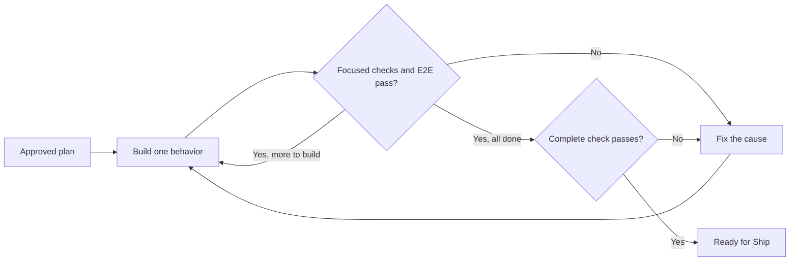
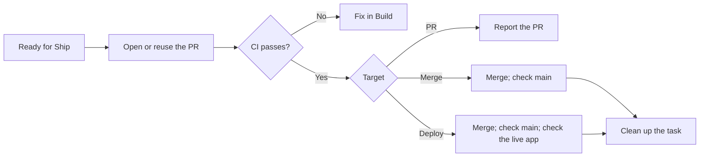
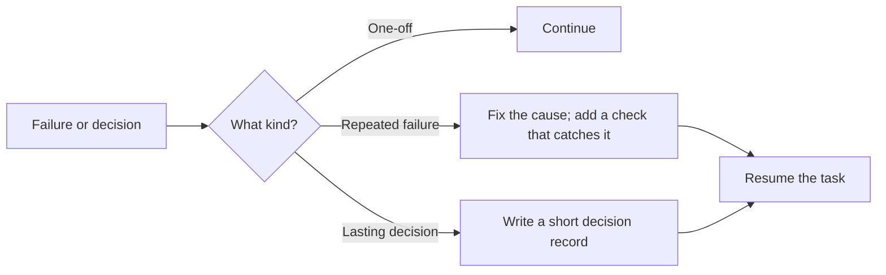
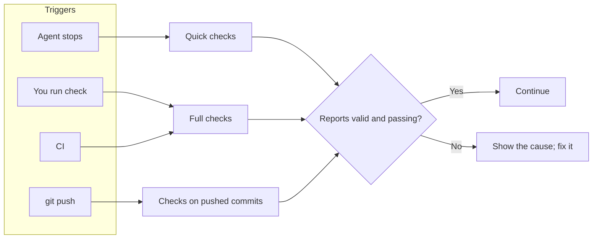

# Hard Eng

**A workflow for one developer who builds with coding agents.**

Hard Eng adds skills, hooks and checks to your repository. Your agent (Claude Code or Codex) then takes each task through four stages. A fifth stage, Learn, runs when a failure repeats or a decision must last.



> **Alpha.** Some hooks and acceptance checks still have limits. See [verified behavior and open gaps](DECISION.md#current-status).

[Setup](#1-setup) · [Plan](#2-plan) · [Build](#3-build) · [Ship](#4-ship) · [Learn](#5-learn) · [Checks](#checks) · [What is enforced](#what-is-enforced)

## 1. Setup

Run this command in the root folder of your Git repository:

```sh
curl -fsSL https://raw.githubusercontent.com/sgaabdu4/hard-eng/main/setup.sh | sh
```

### Start a new project

In an empty repository, add `--new` and a stack name:

```sh
curl -fsSL https://raw.githubusercontent.com/sgaabdu4/hard-eng/main/setup.sh | sh -s -- --new vite
```

| Stack | What you get |
| --- | --- |
| `vite` | React + Vite single-page app with Bun. |
| `nextjs` | Next.js app (App Router, Tailwind) with Bun. |
| `opennext` | Next.js on Cloudflare Workers through OpenNext, with Bun. |
| `flutter` | Flutter app with Riverpod, code generation and localization. |

`--new` does five things:

1. Runs the stack's official scaffold tool, at a pinned version.
2. Adds starter tests, a performance test and architecture boundary rules. Every check passes at once.
3. Replaces other linters with Biome (JavaScript stacks).
4. Pins each package to an exact version: the newest release that your Bun `minimumReleaseAge` rule allows.
5. Commits the project, then installs Hard Eng as usual.

You or your agent still write `PRODUCT.md` and `DESIGN.md`, because only you know the product.

**Which web stack?** The agent asks you. It never picks Next.js by default.

| Choose | When |
| --- | --- |
| Next.js | Public pages that need search ranking or a fast first load, or one project for pages and server code. |
| React + Vite | Apps behind a login, internal tools, and apps that use a separate backend. |

### What setup does

| Your repository | What setup does |
| --- | --- |
| Empty | Stops and asks for a stack. Rerun with `--new STACK` (flutter, nextjs, opennext, vite or python). |
| Python, JavaScript/TypeScript or Dart/Flutter | Installs rules, skills, hooks and checks. Keeps your own instructions, skills, hooks and settings. Reports real conflicts. |
| Another language (Go, Rust, Java/Kotlin, Ruby, PHP, .NET, Swift outside a Flutter app, C/C++, shell) | Basic mode: rules, skills, hooks, CI, secret scans, a Semgrep security scan, and an OSV scan when a lockfile exists. Setup prints a `Gap:` line for each missing language check. |
| Hard Eng already installed | Prepares an update when a newer CI-verified version exists. See [Updates](#updates). |

Setup also:

- Adds shared rules at the top of `AGENTS.md`. Codex and Claude Code (v2.1.277 or later) read this file.
- Removes Claude instruction files that repeat `AGENTS.md`. Move any unique rules into `AGENTS.md` first.
- Connects Appwrite, Sentry, Dart and Marionette when the project uses them. Every Flutter app gets Marionette, pinned to the `marionette_flutter` version in `pubspec.lock`.
- Installs the Appwrite and Flutter skills only when the project uses Appwrite or Dart.
- Never pushes.



After setup, start a new agent session so it loads the installed skills.

### Updates

- At session start, a hook reports the last update result. It then starts the next update in the background, so a session never waits.
- One update runs per repository at a time. It writes `.hard-eng/update.log`.
- The update builds in a separate worktree from the remote base branch. It leaves one commit on the local branch `hard-eng/update`. It never touches your current branch.
- `python3 .hooks/hard-eng.py update-pr` pushes that branch and opens or reuses the "Update Hard Eng" PR. It merges the PR only after every check passes. Rerun it to merge once pending checks finish. `--no-merge` prints the merge command instead.
- The update PR may sit beside your task PR. Fix a failing update PR on its own branch first.
- A refused update retries only when upstream changes, the checkout changes or 24 hours pass. The setup command always retries.
- A failed update never switches off checks. The agent fixes the cause in its own commit, then reruns setup.

### Codex

Start Codex with `codex --enable hooks`, trust the project, then review Hard Eng's hooks with `/hooks`. Review them again when they change. `--yolo` removes sandbox and approval protection; it does not set up hooks. See [Codex hook trust](https://learn.chatgpt.com/docs/hooks#review-and-trust-hooks).

### Requirements

Git, curl, uv, Python 3.12 or later, and the project's SDK and package manager (Bun for JavaScript, Flutter for Dart, Xcode on macOS for Swift in Flutter apps). Dart Decimate needs npm 11.16 or later. Details: [entry command](setup.sh), [installer](setup.py), [new projects](new_project.py), [integrations](.agents/skills/he/references/integrations.md).

## 2. Plan

You do not need to call skills by name. The `he` skill picks the right stage for the agent.

Each task gets one `PLAN.md`. The plan holds the request, the decisions, the proof to collect and the result. If a Ready plan already exists, the agent uses it.

A small change needs no plan. `check` decides this from the whole branch, compared with its merge base on the default branch. A change is small when it is documentation only, or when all of these are true:

- It changes 20 lines or fewer in 3 files or fewer. Documentation files do not count.
- It adds, deletes or renames no file, and changes no binary file.
- It does not touch dependencies, CI, `.hooks/`, `.agents/`, `.claude/`, the gate configuration, `AGENTS.md` or a database.
- It removes no test lines.

`check` prints `Size: small` or `Size: big, because …`. It still runs every other gate. A plan that exists is always validated.

[HE Plan](.agents/skills/he-plan/SKILL.md) does five things:

1. **Research.** Read the code, compare options and check current facts at the source. Test risky assumptions with the cheapest useful check.
2. **Scope.** Write the outcome and the limits. Ask only questions that change the result.
3. **UX.** For visible changes, show a mock or a preview of the real app. Say which one it is.
4. **E2E.** Name the real user journey to test and the expected result, or say why there is none.
5. **Readiness.** Run the Draft check on the starting code (the baseline), then the Ready check.



You choose once how much you take part. **Human-led** work asks you to approve the plan one time. **Autonomous** work continues inside the permission you gave. In both modes, the agent never invents your answers and never widens the delivery.

### Wayfinder (optional)

Use [Wayfinder](.agents/skills/he-plan/references/wayfinding.md) when many open decisions depend on each other, or when you ask for it. It writes a map of tickets: research, your choices, prototypes and prerequisites. Each later session closes one ticket. When the direction is clear, normal planning continues.

Related skills: [Research](.agents/skills/research/SKILL.md), [Codebase Design](.agents/skills/codebase-design/SKILL.md) and [UX guidance](.agents/skills/he-plan/references/ux.md).

## 3. Build

[HE Build](.agents/skills/he-build/SKILL.md) carries out the approved plan on a task branch. The agent builds one complete behavior at a time. After each one, it runs focused checks, reviews the diff and runs the planned [E2E](.agents/skills/e2e/SKILL.md) journey.



The agent records the real proof in the plan, then marks it Complete. Only E2E proof that needs a live deployment may stay pending.

## 4. Ship

[HE Ship](.agents/skills/he-ship/SKILL.md) delivers only the target you allowed: **PR**, **Merge** or **Deploy**.



- Before a big change ships, the other agent reviews it: `python3 .hooks/hard-eng.py challenge`. Codex reviews Claude Code work. Claude Code reviews Codex work.
- For visible changes, the agent compares the before and after states. It posts an image pair only when the look changed.
- The agent checks outgoing text for secrets, personal data and private project details.
- The PR body has a non-empty `Undo:` line with the steps to undo the change. `ship` refuses a PR without it.
- `ship` refuses a PR that is behind its base branch. Two PRs that pass alone can break main together, so the agent rebases and the checks run again.
- Cleanup happens only after a confirmed merge. Unrelated worktrees stay.

## 5. Learn

[HE Learn](.agents/skills/he-learn/SKILL.md) runs when a failure repeats, a bug is found on main, or a decision must last. For a bug on main, the agent names the check that should have caught it. Before the fix, it adds a case at that check that fails on the merged code.



The agent prefers a test, checker or hook over new instructions. A skill change is the last choice.

Decision records live in `docs/adr/`. Each one has an `Applies to:` line with path prefixes. When a session changes a file under that prefix, the Stop hook shows the decision once and asks the agent to confirm the change follows it. `check` flags a record without that line, and a record whose last listed file a change deletes.

## Checks

Each project has a `hard-eng.gates.json` file. It lists the check commands, their reports, time budgets and how packages depend on each other. Hard Eng finds supported packages by itself, monorepos included. A missing required check fails the configuration.

| Stack | Required checks | Tools | Extra checks when they apply |
| --- | --- | --- | --- |
| Python | Format, lint, complexity, strict types, annotations, tests with coverage, dead code, duplicate code, dependencies, performance. | Ruff, Pyrefly, Pytest with coverage, Vulture, jscpd, Deptry. | Import Linter, when the package has real import roots. |
| JavaScript and TypeScript | Format and lint, focused-test detection, types, typing style, tests with coverage, dead code and duplicates, performance. TypeScript packages also need architecture boundaries. | Biome, TypeScript, the project test runner, Fallow. Zod is the suggested validator. | React Doctor for React. Existing `build`, integration-test, UI-test, generated-code, boundary and `check:fallow` scripts join the gate. |
| Dart and Flutter | Format, analyzer, tests with coverage, dead code and duplicates, architecture boundaries, performance. | Dart format and analyzer, Dart test with coverage, Dart Decimate. | A boundary rule needs real project prefixes. Flutter build or device proof stays a project task. |
| Swift in a Flutter app (`ios/`, `macos/`) | One group per platform folder that holds Swift beyond the starter files `flutter create` wrote (a starter file counts until its text differs from every Flutter template): Swift format and lint, Xcode build and tests with coverage, duplicates, a Swift Semgrep scan, a reviewed `performance_exception`. | `swift format`, `xcodebuild` with `xcresulttool` and `xccov`, jscpd, Semgrep. | CocoaPods adds `pod install --deployment`. Needs macOS: CI runs only the Swift groups on `macos-latest`, and only when one is affected; every other group stays on Linux. Plain SwiftPM packages and pure Xcode apps stay in basic mode. |

Rules for every language:

- [HE-COVERAGE-MIN](.agents/skills/he/references/requirements.md#he-coverage-min): tests cover at least 70% of lines.
- [HE-PERFORMANCE-SUITE](.agents/skills/he/references/requirements.md#he-performance-suite): a performance suite, or a reviewed exception ([how to review](.agents/skills/he/references/gates.md)).
- [HE-UNTRUSTED-JSON](.agents/skills/he/references/requirements.md#he-untrusted-json): parsed JSON is `unknown` until validated. Type casts fail, except `as const`.
- [HE-FILE-LENGTH](.agents/skills/he/references/requirements.md#he-file-length): files longer than 1000 lines need a reviewed exception.
- Checks read each tool's report as well as its exit code. A missing, old, partial or failing report fails.
- Fill in [PRODUCT.md](PRODUCT.md) and [DESIGN.md](DESIGN.md) for your project.

Shared checks:

| When the repository has | Hard Eng runs |
| --- | --- |
| Any supported code | Gitleaks on current files and on Git history (a project can switch off the history scan). Semgrep security scan. |
| GitHub Actions workflows | Actionlint and Zizmor. |
| Shell scripts | ShellCheck. |
| Deployment configuration | A deployment configuration check, such as Trivy. |
| A lockfile | OSV vulnerability scan. |

Checks run only for the packages a change affects, their known dependents and the shared checks. Pre-push leaves dependents to CI. A change to the gate configuration, or an unknown package link, normally runs everything. A push to the base branch reuses the merged PR's passed checks when the tree is the same. `python3 .hooks/hard-eng.py ci-usage` reports billed CI minutes. Setup keeps your existing workflows. It adds a workflow only when none exists and shipping is configured. Generated workflows run on `ubuntu-latest` unless the repository variable `CI_RUNS_ON` holds a JSON `runs-on` value, such as `"ubuntu-24.04"` or `["self-hosted", "linux"]`. A private repository can use it to run on its own self-hosted runner. Leave it unset in a public repository, where outside pull requests could run on that runner. A project with a Swift group gets separate jobs: `hard-eng-linux` runs every affected group except Swift, `hard-eng-apple` runs only the affected Swift groups and the dependency installs they need, and `hard-eng` waits for both, so the required check keeps its name. The Swift job runs on `macos-latest` unless the repository variable `CI_MACOS_RUNS_ON` holds a JSON `runs-on` value, such as `["self-hosted", "macOS"]`. Leave it unset in a public repository. The Swift job is skipped when no Swift group is affected, and runs when the impact step fails. The Bun that launches the tools is requested at an exact version, so a runner's installed Bun is reused: the project's pinned Bun, else the newest stable release at least 2 days old, else `latest` when the lookup fails or runs outside GitHub Actions. A runner that already exports `MISE_DATA_DIR`, `MISE_CACHE_DIR`, `MISE_STATE_DIR` or `BUN_INSTALL_CACHE_DIR` keeps them, so a pre-installed tool set or a persistent cache is reused. The workflow sets only the ones that are missing, under the runner's temporary folder. Setup also moves those generated lines in any other workflow file to the same form.

More detail: [gates](.agents/skills/he/references/gates.md), [testing](.agents/skills/he/references/testing.md), [shipping](.agents/skills/he-ship/references/checks.md), [this repository's gate file](hard-eng.gates.json).

## Security

Semgrep checks code. OSV checks lockfiles and images. Scanners only see what they are pointed at. They do not replace server-side access control or rotating a leaked secret. [Security Review](.agents/skills/security-review/SKILL.md) examines changes to trust boundaries. Skills and passing checks never give permission to publish, spend money or change access.

## What is enforced

Skills guide the agent. Hooks and checks enforce. Plan checks validate the plan's fields and declared results. They cannot prove that a screenshot is real, judge design quality or prove that the agent followed every instruction. Hooks work only when the host supports them and you trust them.

| When | What runs |
| --- | --- |
| Session start | Reports the last update result. Starts the next update in the background. |
| Claude runs a shell command | Denies a main-session wait that sleeps in the foreground ([HE-NO-FOREGROUND-POLL](.agents/skills/he/references/requirements.md#he-no-foreground-poll)). The agent runs the job in the background and gets a notice when it exits. |
| Agent stops | Checks the plan handoff. After code changes, runs quick checks on this session's changes: format, lint, types and the current-files secret scan. Tests run at pre-push and in CI. A failure shows the failed checks and the first one's output. |
| `git push` | Checks the pushed commits in a separate worktree, for the changed packages. With Vitest or Jest, runs only the related tests. Then reports changed lines whose tests miss small deliberate bugs (mutation report; it never blocks the push and stops after `pre_push_mutation_seconds`, default 120 s). |
| `git worktree add` | Links the main checkout's ignored `.env*` files, `.claude/settings.local.json` and `CLAUDE.local.md` into the new worktree. It never reads or copies their contents. Copies an ignored hooks folder, such as Husky's, so pushes from the worktree are checked. Initializes submodules. |
| CI | Runs every configured check. Fails the job on any failure. |
| Every `check` | Enforces [HE-NO-SWITCH-OFF](.agents/skills/he/references/requirements.md#he-no-switch-off), [HE-COMMENT-LINES](.agents/skills/he/references/requirements.md#he-comment-lines) and the [requirement registry](.agents/skills/he/references/requirements.md). |

Shipping blocks when the installed Hard Eng is out of date or its version cannot be confirmed. It names the next step: run `update-pr`, fix the failing update PR, wait for it, or rebase after it merges.



## Read next

- [Product intent and boundaries](PRODUCT.md)
- [Technical component overview](DESIGN.md)
- [Current verification, decisions, and acceptance gaps](DECISION.md#current-status)
- [Research guidance](.agents/skills/research/SKILL.md)
