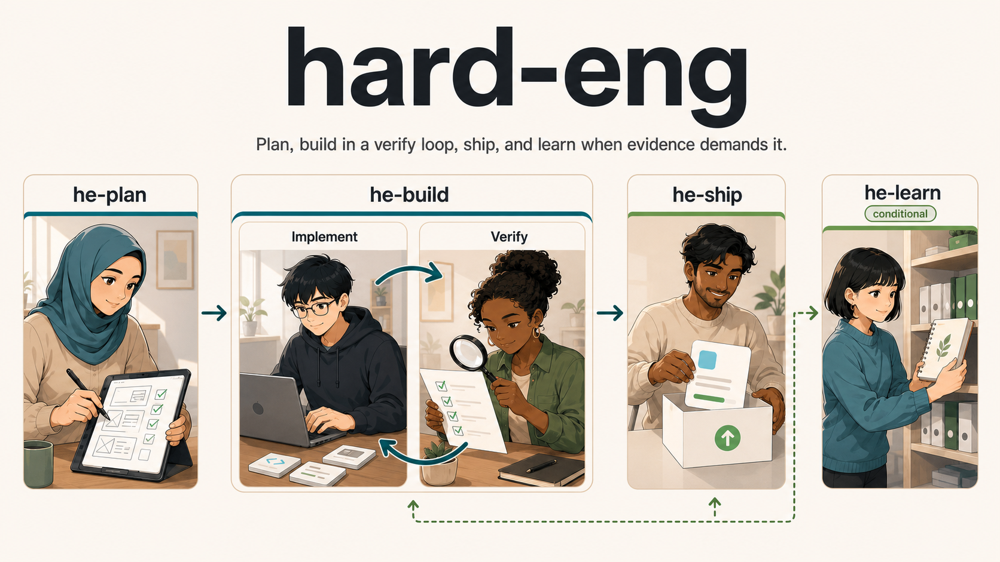
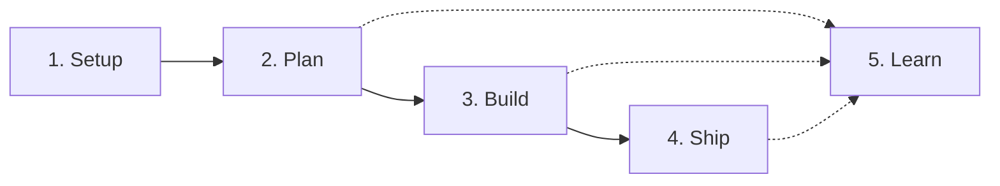
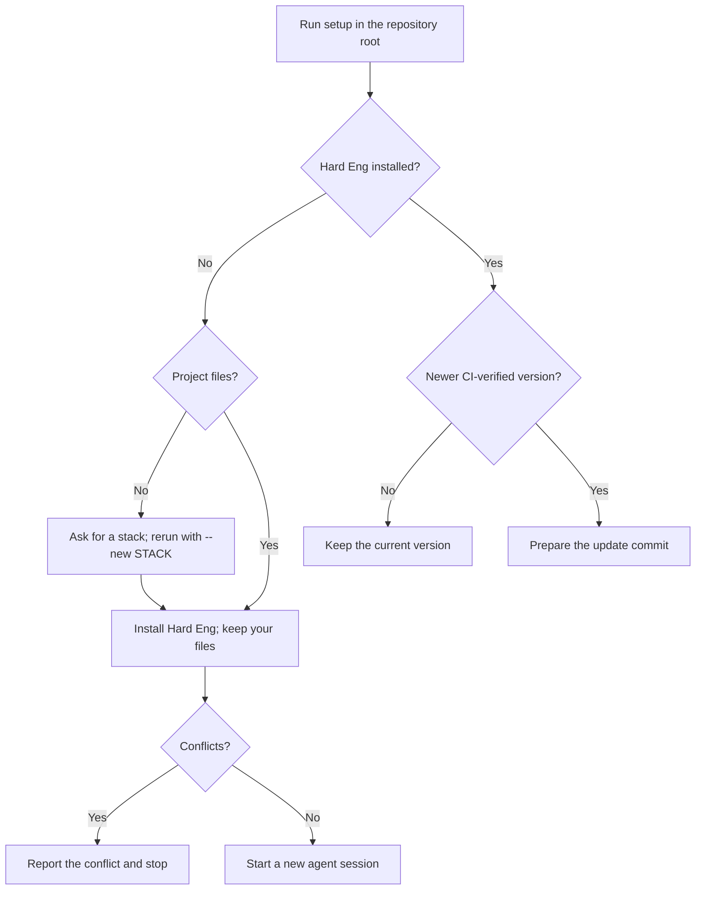
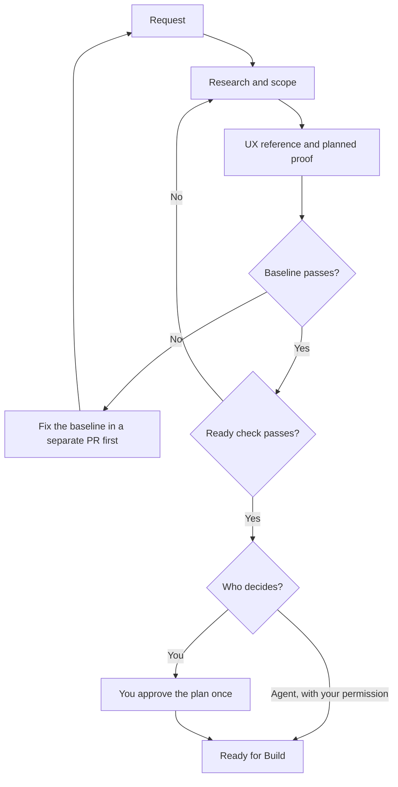
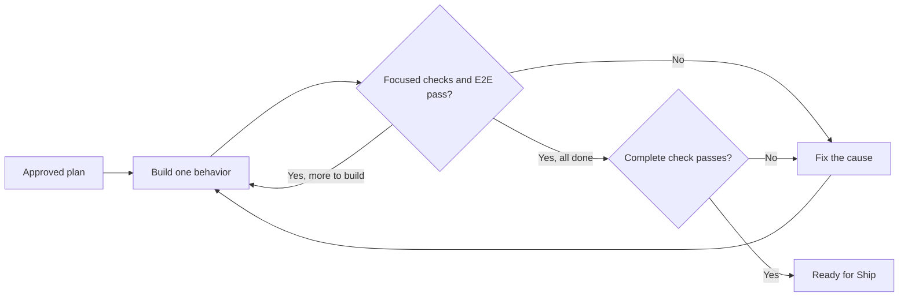
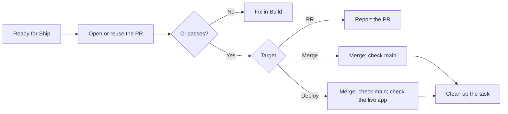
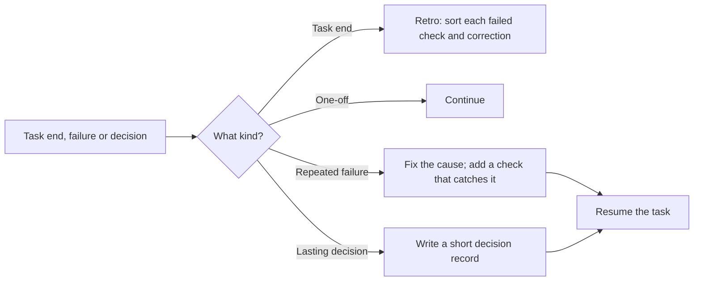
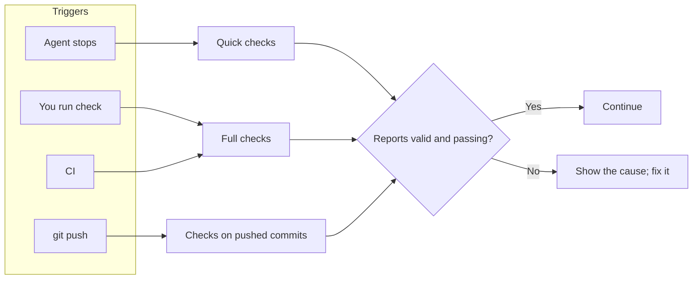

# Hard Eng

**A workflow for one developer who builds with coding agents.**

Hard Eng adds skills, hooks and checks to your repository. Your agent (Claude Code or Codex) then takes each task through four stages. A fifth stage, Learn, runs a retro at the end of each task. It also runs when a failure repeats or a decision must last.



> **Alpha.** Some hooks and acceptance checks still have limits. See [verified behavior and open gaps](DECISION.md#current-status).

[Setup](#1-setup) · [Plan](#2-plan) · [Build](#3-build) · [Ship](#4-ship) · [Learn](#5-learn) · [Checks](#checks) · [What is enforced](#what-is-enforced)

## What "hard" means

Hard Eng is strict on purpose. It refuses bad code. It does not only give a warning.

- **Old code too.** The full `check` reads every tracked file and every new file that Git does not ignore, not only your new lines. The [quick checks](#quick-checks) that run when an agent stops look only at this session's changes. An old case of each rule below fails until someone fixes it.
- **No switch-offs.** A comment or config line that turns a check off fails, even an old one. Generated output is exempt. So are the folders that Hard Eng installs: `.hooks/`, `.agents/` and `.claude/`.
- **Fix the cause.** Each of these failures names the fix. For example, a wait with no delay, or a wait for the next frame, fails in app code. The fix is to change the order of events.
- **No leftover notes.** TODO, FIXME, HACK and XXX in a comment fail. The same words in a string pass. A comment block of two or more lines fails. A markdown file that no other file names fails. README, AGENTS and a few other standard names pass. So do the folders that Hard Eng installs. The comment rules skip generated output and `.agents/` only.

To add Hard Eng to an older project, fix each case of these rules that the first full check finds. Their findings never go into the debt record. Some other checks can record their old findings one time at install. After that, the record can only get smaller ([HE-DEBT-SHRINK-ONLY](.agents/skills/he/references/requirements.md#he-debt-shrink-only)).

For every rule and when it runs, see [What is enforced](#what-is-enforced).

## 1. Setup

Run this command in the root folder of your Git repository:

```sh
curl -fsSL https://raw.githubusercontent.com/sgaabdu4/hard-eng/main/setup.sh | sh
```

### Start a new project

In an empty repository, add `--new` and a stack name:

```sh
curl -fsSL https://raw.githubusercontent.com/sgaabdu4/hard-eng/main/setup.sh | sh -s -- --new vite
```

| Stack | What you get |
| --- | --- |
| `vite` | React + Vite single-page app with Bun. |
| `nextjs` | Next.js app (App Router, Tailwind) with Bun. |
| `opennext` | Next.js on Cloudflare Workers through OpenNext, with Bun. |
| `flutter` | Flutter app with Riverpod, code generation and localization. |
| `python` | Python app with uv. |

`--new` does five things:

1. Runs the stack's official scaffold tool. The `vite`, `nextjs` and `opennext` tools run at a pinned version. Flutter and uv run at the version you have installed.
2. Adds starter tests, a performance test and architecture boundary rules. Every check passes at once.
3. Replaces other linters with Biome (JavaScript stacks).
4. Pins each package to an exact version. Web stacks get the newest release that is at least two days old. Flutter gets the version pub picks. Python gets the versions `uv lock` picks.
5. Commits the project, then installs Hard Eng as usual.

You or your agent still write `PRODUCT.md` and `DESIGN.md`, because only you know the product.

**Which web stack?** The agent asks you. It never picks Next.js by default.

| Choose | When |
| --- | --- |
| Next.js | Public pages that need search ranking or a fast first load, or one project for pages and server code. |
| React + Vite | Apps behind a login, internal tools, and apps that use a separate backend. |

### What setup does

| Your repository | What setup does |
| --- | --- |
| Empty | Stops and asks for a stack. Rerun with `--new STACK` (flutter, nextjs, opennext, vite or python). |
| Python, JavaScript/TypeScript or Dart/Flutter | Installs rules, skills, hooks and checks. Keeps your own instructions, skills, hooks and settings. Reports real conflicts. |
| Another language (Go, Rust, Java/Kotlin, Ruby, PHP, .NET, Swift outside a Flutter app, C/C++, shell) | Basic mode: rules, skills, hooks, CI, secret scans, a Semgrep security scan, and an OSV scan when a lockfile exists. Setup prints a `Gap:` line for each missing language check, and the agent files each one with `gap-issue`. |
| Hard Eng already installed | Prepares an update when a newer CI-verified version exists. See [Updates](#updates). |

Setup also:

- Adds shared rules at the top of `AGENTS.md`. Codex and Claude Code (v2.1.277 or later) read this file.
- Removes Claude instruction files that only import or link to `AGENTS.md`.
- Stops at any other Claude instruction file. This includes `CLAUDE.local.md`, and such files in subfolders or parent folders. Then do this:
  1. Move its shared rules into `AGENTS.md`.
  2. Move private rules outside the repository (for example `~/.claude/CLAUDE.md`).
  3. Remove the file.
- Connects Appwrite, Sentry, Dart and Marionette when the project uses them. Every Flutter app gets Marionette, pinned to the `marionette_flutter` version in `pubspec.lock`.
- Installs the Appwrite and Flutter skills only when the project uses Appwrite or Dart.
- Installs the [Trello coordinator](.agents/skills/trello-coordinator/SKILL.md) skill only when `trello.json` is at the repository root. This skill runs the project's Trello board. It answers card comments, gives work to worker agents and moves cards with proof.
- Never pushes.



After setup:

- Start a new agent session, so it loads the installed skills.
- `git push` is refused until `hard-eng.gates.json` has a `shipping` section. The agent adds it before the first delivery ([shipping](.agents/skills/he-ship/references/checks.md)).

### Updates

- At session start, a hook reports the last update result. It then starts the next update in the background, so a session never waits When that run ends, it removes merged worktrees and branches that nobody has used for 24 hours, and idle Rust build folders. It keeps anything with changes, a stash, an open pull request or a running process, and it adds one line to the next report when it removed something.
- One update runs per repository at a time. It writes `.hard-eng/update.log`.
- The update builds in a separate worktree from the remote base branch. It leaves one commit on the local branch `hard-eng/update`. It never touches your current branch.
- `python3 .hooks/hard-eng.py update-pr` pushes that branch and opens or reuses the "Update Hard Eng" PR.
  - It merges the PR only after every check passes. Rerun it to merge once pending checks finish.
  - `--no-merge` prints the merge command instead.
- A newer release gets a load test before the push. For that test, `update-pr` loads the gate file and the debt file of the update branch. It uses the hooks of that release. If the load fails, it stops and gives the fix steps.
- The update PR may sit beside your task PR. Fix a failing update PR on its own branch first.
- The update reads only the files that Git tracks on the remote base branch. If it would replace an untracked or ignored local file, it stops and names that file.
- A refused update retries after a new release, a new commit on the remote base branch or 24 hours. The setup command always retries.
- A refused update never switches off checks. The agent:
  1. Fixes the cause in its own commit.
  2. Merges that commit into the base branch through a PR.
  3. Reruns setup.
- When a local file blocks the update, the agent moves it away and reruns setup.

### Codex

1. Start Codex.
2. Trust the project.
3. Review Hard Eng's hooks with `/hooks`. Review them again when they change.

`--yolo` removes sandbox and approval protection. It does not set up hooks. See [Codex hook trust](https://learn.chatgpt.com/docs/hooks#review-and-trust-hooks).

### Requirements

| You need | Note |
| --- | --- |
| Git, curl, uv, Bun, Python 3.12 or later | Bun installs the check tools on every stack. |
| The project's SDK and package manager | Flutter for Dart. Xcode on macOS for Swift in Flutter apps. |
| The GitHub CLI (`gh`) | `update-pr`, `ship` and `gap-issue` need it. |
| npm 11.16 or later | Dart Decimate needs it. |

Details: [entry command](setup.sh), [installer](setup.py), [new projects](new_project.py), [integrations](.agents/skills/he/references/integrations.md).

## 2. Plan

You do not need to call skills by name. The `he` skill picks the right stage for the agent.

Each task gets one `PLAN.md`. The plan holds the request, the decisions, the proof to collect and the result. If a Ready plan already exists, the agent uses it.

A small change needs no plan. `check` decides this. It compares the whole branch with its merge base on the default branch. A change is small when it is documentation only, or when all of these are true:

- It changes 20 lines or fewer in 3 files or fewer. Documentation files do not count.
- It adds, deletes or renames no file, and changes no binary file.
- It does not touch dependencies, CI, `.hooks/`, `.agents/`, `.claude/`, the gate configuration, `AGENTS.md` or a database.
- It removes no test lines. In a test file with code, two kinds of line are not test lines. They are an empty line, and an import line that names no test.

`check` prints `Size: small` or `Size: big, because …`. After `Size: big` with no plan, `check` stops and runs no gate. A plan that exists is always validated.

[HE Plan](.agents/skills/he-plan/SKILL.md) does five things:

1. **Research.** Read the code, compare options and check current facts at the source. Test risky assumptions with the cheapest useful check.
2. **Scope.** Write the outcome and the limits. Ask only questions that change the result.
3. **UX.** For visible changes, show a mock or a preview of the real app. Say which one it is.
   - Exception: a change to a screen that exists. It gets before and after captures of the real app, not a hand-made mock ([HE-REAL-APP-PREVIEW](.agents/skills/he/references/requirements.md#he-real-app-preview)).
4. **E2E.** Name the real user journey to test and the expected result, or say why there is none.
5. **Readiness.** Run the Draft check on the starting code (the baseline), then the Ready check.



You choose once how much you take part. **Human-led** work asks you to approve the plan one time. **Autonomous** work continues inside the permission you gave. In both modes, the agent never invents your answers and never widens the delivery.

### Plan lines

`check` reads the form of these plan lines. It cannot prove that they are true. An older Complete plan that no change edits is not held to the newer lines.

| Line | What it holds |
| --- | --- |
| `Sources:` and its rows | Each source that you gave, and one row for each person, screen, rule and outcome that the sources name ([HE-SOURCE-COVERAGE](.agents/skills/he/references/requirements.md#he-source-coverage)). A second reader checks the rows when there is more than one source, or one large source. That reader is an agent that gets only the sources and the plan. |
| `Same cause:` | The earlier fixes of the same cause, and every other place where it can occur. |
| `Single source:` | The one owner of each rule, value or type that the change touches. |
| `Real service:` | One real run of each changed call to an outside service ([HE-REAL-SERVICE-RUN](.agents/skills/he/references/requirements.md#he-real-service-run)). The run uses a test account, a sandbox or a staging project, and test records only. The agent also makes the service refuse one time for each refusal that the code tells apart by its error. |
| `Retro:` | The prevention for each failed check and each correction of the task. |

### Wayfinder (optional)

Use [Wayfinder](.agents/skills/he-plan/references/wayfinding.md) when many open decisions depend on each other, or when you ask for it. It writes a map of tickets: research, your choices, prototypes and prerequisites. Each later session closes one ticket. When the direction is clear, normal planning continues.

Related skills: [Research](.agents/skills/research/SKILL.md), [Codebase Design](.agents/skills/codebase-design/SKILL.md) and [UX guidance](.agents/skills/he-plan/references/ux.md).

## 3. Build

[HE Build](.agents/skills/he-build/SKILL.md) carries out the approved plan on a task branch. The agent builds one complete behavior at a time. After each one, it runs focused checks, [reviews the diff](.agents/skills/code-review/SKILL.md) and runs the planned [E2E](.agents/skills/e2e/SKILL.md) journey.



The agent records the real proof in the plan, then marks it Complete. Only E2E proof that needs a live deployment may stay pending.

## 4. Ship

[HE Ship](.agents/skills/he-ship/SKILL.md) delivers only the target you allowed: **PR**, **Merge** or **Deploy**.



- Before a big change ships, the agent runs `python3 .hooks/hard-eng.py challenge`, and the other agent reviews the change. Codex reviews Claude Code work. Claude Code reviews Codex work. When the review cannot run or finish, the PR still ships and says that the review was not done.
- For visible changes, the agent compares the before and after states. It posts an image pair only when the look changed.
- The agent checks outgoing text for secrets, personal data and private project details.
- The PR body has three required parts. `ship` refuses a PR without them.
  - A line that starts with `Undo:`. It gives the steps to undo the change on that line.
  - A line that starts with `Not checked:`. It names what no check covered.
  - Two or more Mermaid diagrams, for the states before and after.
- `ship` also refuses a wall of text: more than 6,000 visible characters, or one visible line over 600. Long lists go into a folded block.
- `ship` refuses a PR that is behind its base branch. Two PRs that pass alone can break main together, so the agent rebases and the checks run again.
- `ship` merges with a rebase merge of the head that it checked. It refuses a squash and a merge commit.
- A PR holds at most 100 commits ([HE-PR-COMMITS](.agents/skills/he/references/requirements.md#he-pr-commits)). `ship` refuses more, and each `check` except `--quick` warns from 80. The cap does not apply to the Hard Eng update PR. It also does not apply to a PR into a branch other than the shipping base.
- Cleanup happens only after a confirmed merge. Unrelated worktrees stay.

## 5. Learn

[HE Learn](.agents/skills/he-learn/SKILL.md) runs a retro at the end of each task. It also runs when a failure repeats, a bug is found on main, or a decision must last.

For a bug on main, the agent names the check that should have caught it. Before the fix, it adds a case at that check that fails on the merged code.



The agent prefers a test, checker or hook over new instructions. A skill change is the last choice.

The Stop hook counts each failed check in `.hard-eng/failures.json`. When the same failure shows again after the checkout changed, the hook names it as a repeat.

Decision records live in `docs/adr/`:

- Each one has an `Applies to:` line with path prefixes.
- When a session changes a file under that prefix, the Stop hook shows the decision once. It asks the agent to confirm that the change follows it.
- `check` flags two cases: a record without that line, and a record whose last listed file a change deletes ([HE-ADR-SCOPE](.agents/skills/he/references/requirements.md#he-adr-scope)).

## Checks

Each project has a `hard-eng.gates.json` file. It lists the check commands, their reports, time budgets and how packages depend on each other. Hard Eng finds supported packages by itself, monorepos included. A missing required check fails the configuration.

| Stack | Required checks | Tools | Extra checks when they apply |
| --- | --- | --- | --- |
| Python | Format, lint, complexity, strict types, annotations, tests with coverage, dead code, duplicate code, dependencies, performance. | Ruff, Pyrefly, Pytest with coverage, Vulture, jscpd, Deptry. | Import Linter, when the package has real import roots. |
| JavaScript and TypeScript | Format and lint, focused-test detection, types, typing style, tests with coverage, dead code and duplicates, performance. The dead-code scan also checks the boundary rules of `.fallowrc.json`. | Biome, TypeScript, the project test runner, Fallow. Zod is the suggested validator. | React Doctor for React. Existing `build`, integration-test, UI-test, generated-code, boundary and `check:fallow` scripts join the gate. |
| Dart and Flutter | Format, analyzer, tests with coverage, dead code and duplicates, architecture boundaries, performance. | Dart format and analyzer, Dart test with coverage, Dart Decimate. | A boundary rule needs real project prefixes. Flutter build or device proof stays a project task. |
| Swift in a Flutter app (`ios/`, `macos/`) | Swift format and lint, Xcode build and tests with coverage, duplicates, a Swift Semgrep scan, a reviewed `performance_exception`. | `swift format`, `xcodebuild` with `xcresulttool` and `xccov`, jscpd, Semgrep. | CocoaPods adds `pod install --deployment`. See [Swift groups](#swift-groups). |

### Swift groups

- A Swift group covers one platform folder, `ios/` or `macos/`.
- A folder gets a group only when it holds Swift beyond the starter files that `flutter create` wrote. A starter file counts as one until its text differs from every Flutter template.
- The Swift checks need macOS. CI runs only the Swift groups on `macos-latest`, and only when one is affected. Every other group stays on Linux.
- Plain SwiftPM packages and pure Xcode apps stay in basic mode.

### Rules and shared checks

Rules for every language:

- [HE-COVERAGE-MIN](.agents/skills/he/references/requirements.md#he-coverage-min): tests cover at least 70% of lines.
- [HE-PERFORMANCE-SUITE](.agents/skills/he/references/requirements.md#he-performance-suite): a performance suite, or a reviewed exception ([how to review](.agents/skills/he/references/gates.md)).
- [HE-UNTRUSTED-JSON](.agents/skills/he/references/requirements.md#he-untrusted-json): parsed JSON is `unknown` until validated. Type casts fail, except `as const`.
- [HE-FILE-LENGTH](.agents/skills/he/references/requirements.md#he-file-length): files longer than 1000 lines need a reviewed exception.
- [HE-HOT-PATH](.agents/skills/he/references/requirements.md#he-hot-path): the `security` gate fails known slow patterns across the whole repository; `python3 .hooks/hard-eng.py hot-paths` lists them.
- Checks read each tool's report as well as its exit code. A missing, old, partial or failing report fails.
- Fill in [PRODUCT.md](PRODUCT.md) and [DESIGN.md](DESIGN.md) for your project.

Shared checks:

| When the repository has | Hard Eng runs |
| --- | --- |
| Any supported code | Gitleaks on current files and on Git history (a project can switch off the history scan). Semgrep security scan. |
| GitHub Actions workflows | Actionlint and Zizmor. |
| Shell scripts | ShellCheck. |
| Deployment configuration | A deployment configuration check, such as Trivy. |
| A lockfile | OSV vulnerability scan. |

### Which checks run

- Checks run only for the packages that a change affects, their known dependents and the shared checks.
- Pre-push leaves dependents to CI.
- A change to the gate configuration, or an unknown package link, normally runs everything.

### Reuse of passed checks

- A push that lands one merged PR reuses that PR's passed checks when the tree is the same.
- A release PR can go from the base branch into another branch. Such a PR reuses the passed checks of its head commit the same way.

### What blocks a merge

- A fresh clone has no pre-push hook until setup runs.
- `--no-verify` skips the pre-push hook.
- So only a required shipping check on the base branch blocks a merge. By default, that check is `hard-eng`.

### CI minutes

`python3 .hooks/hard-eng.py ci-usage [--runs 150]` reports billed CI minutes. It splits the slowest jobs into queue, setup and run time.

### Workflows and runners

- Setup keeps your existing workflows. It adds a workflow only when none exists and shipping is configured.
- Generated workflows run on `ubuntu-latest`, unless the repository variable `CI_RUNS_ON` holds a JSON `runs-on` value. Examples: `"ubuntu-24.04"` or `["self-hosted", "linux"]`.
- A private repository can use the variable to run on its own self-hosted runner.
- Leave the variable unset in a public repository, where outside pull requests could run on that runner.
- Every PR's job goes to that runner, whoever opened it. If the runner serves only some people, the jobs of other authors stay queued for 24 hours, then fail.

### Swift jobs

A project with a Swift group gets separate jobs:

| Job | What it does |
| --- | --- |
| `hard-eng-linux` | Runs every affected group except Swift. |
| `hard-eng-apple` | Runs only the affected Swift groups and the dependency installs they need. |
| `hard-eng` | Waits for both, so the required check keeps its name. |

- The Swift job runs on `macos-latest`, unless the repository variable `CI_MACOS_RUNS_ON` holds a JSON `runs-on` value. Example: `["self-hosted", "macOS"]`.
- Leave that variable unset in a public repository.
- The Swift job is skipped when no Swift group is affected. It runs when the impact step fails.

### Bun version and caches

- The Bun that launches the tools is requested at an exact version, so a runner's installed Bun is reused. The version is the first of these:
  1. The project's pinned Bun.
  2. The newest stable release that is at least 2 days old.
  3. `latest`, when the lookup fails or runs outside GitHub Actions.
- A runner can already export `MISE_DATA_DIR`, `MISE_CACHE_DIR`, `MISE_STATE_DIR` or `BUN_INSTALL_CACHE_DIR`. That runner keeps them, so a pre-installed tool set or a persistent cache is reused.
- The workflow sets only the ones that are missing, under the runner's temporary folder.
- Setup also moves those generated lines in any other workflow file to the same form.

More detail: [gates](.agents/skills/he/references/gates.md), [testing](.agents/skills/he/references/testing.md), [shipping](.agents/skills/he-ship/references/checks.md), [this repository's gate file](hard-eng.gates.json). All commands: `python3 .hooks/hard-eng.py --help`.

## Security

- Semgrep checks code. OSV checks lockfiles and images.
- Scanners only see what they are pointed at. They do not replace server-side access control or rotating a leaked secret.
- [Security Review](.agents/skills/security-review/SKILL.md) examines changes to trust boundaries.
- Skills and passing checks never give permission to publish, spend money or change access.

## What is enforced

Skills guide the agent. Hooks and checks enforce.

- Plan checks validate the plan's fields and declared results. They cannot prove that a screenshot is real, judge design quality or prove that the agent followed every instruction.
- Hooks work only when the host supports them and you trust them.

| When | What runs |
| --- | --- |
| Session start | Reports the last update result. Starts the next update in the background, which also tidies merged idle worktrees, branches and Rust build folders. |
| Claude runs a shell command | Denies a main-session wait that sleeps in the foreground ([HE-NO-FOREGROUND-POLL](.agents/skills/he/references/requirements.md#he-no-foreground-poll)). The agent runs the job in the background and gets a notice when it exits. |
| Agent stops | Checks the plan handoff. After code changes, runs [quick checks](#quick-checks) on this session's changes. |
| `git push` | Checks the pushed commits in a separate worktree, for the changed packages. With Vitest or Jest, runs only the related tests. Then gives a [mutation report](#mutation-report). |
| `git worktree add` | Prepares the [new worktree](#new-worktrees): local files, the hooks folder and submodules. |
| CI | Runs the checks for the affected packages, their dependents and the shared checks. A change that no package reads gets only the secret scan. Fails the job on any failure. |
| Every `check` | Enforces [HE-NO-SWITCH-OFF](.agents/skills/he/references/requirements.md#he-no-switch-off), [HE-COMMENT-LINES](.agents/skills/he/references/requirements.md#he-comment-lines) and the [requirement registry](.agents/skills/he/references/requirements.md). |

Before the merge, shipping blocks when the installed Hard Eng is out of date or its version cannot be confirmed. It names the next step: run `update-pr`, fix the failing update PR, wait for it, or rebase after it merges.

### More rules

The [requirement registry](.agents/skills/he/references/requirements.md) holds each rule one time, in full. This table gives the short meaning of the rules that this file does not explain in another place:

| Rule | Short meaning | Proof |
| --- | --- | --- |
| [HE-NO-SWITCH-OFF](.agents/skills/he/references/requirements.md#he-no-switch-off) | The check reads tracked files and new files that Git does not ignore. None holds a suppression, a skipped or focused test or a test retry. None holds a scanner ignore marker or an ignore entry in a scanner config file. Old ones fail too. Generated output and the folders `.hooks/`, `.agents/` and `.claude/` are exempt. A change also removes no more `assert` or `expect(` lines from test files than it adds. | Check |
| [HE-COMMENT-LINES](.agents/skills/he/references/requirements.md#he-comment-lines) | The check reads tracked source files and new ones that Git does not ignore. None has a comment block of more than one line, or a TODO, FIXME, HACK or XXX marker in a comment. Old ones fail too. Generated output and `.agents/` are exempt. | Check |
| [HE-DEBT-SHRINK-ONLY](.agents/skills/he/references/requirements.md#he-debt-shrink-only) | In the change that installs Hard Eng, `adopt` can record the old findings one time in `hard-eng.debt.json`. Later changes only remove lines. | Check |
| [HE-UI-SOURCE](.agents/skills/he/references/requirements.md#he-ui-source) | Added UI lines hold no `transition` on all properties. They also hold none of the listed colour literals outside a theme or token file. | Check |
| [HE-NO-TEXT-WALLS](.agents/skills/he/references/requirements.md#he-no-text-walls) | On-screen text comes in short blocks. A block has at most 25 words and 3 sentences, and a sentence has at most 20 words. The command `text-walls` lists the hits. | Check |
| [HE-SEND-LIMIT](.agents/skills/he/references/requirements.md#he-send-limit) | Code that runs with no person present, and can send, has a maximum number of sends for each period. A send that answers one outside event can use one send for each event ID. | Guidance, applied in review |
| [HE-OUTPUT-PLAIN](.agents/skills/he/references/requirements.md#he-output-plain) | Text for people is plain, simplified technical English. | Guidance |
| [HE-YAGNI](.agents/skills/he/references/requirements.md#he-yagni) | The agent adds a file, dependency, abstraction, setting or stored state only for a current agreed requirement. Existing code or a direct command must not be enough for it. | Guidance |

### Quick checks

- The quick checks are format, lint, types and the current-files secret scan. Tests run at pre-push and in CI.
- A quick check also runs a package's install command and its `generated` check until both pass in this checkout. It runs them again after a lock file changes or an install folder is added or removed.
- A failure shows the failed checks and the first one's output.

How a quick check runs `dart analyze --fatal-infos`:

| Case | What is analysed |
| --- | --- |
| Dart files changed | Only the changed Dart files first. If that first run finds nothing, that is the result. Only the full check finds an unchanged file that the change breaks. |
| That first run finds something, or a Dart file was deleted | The whole package. |
| A `.yaml`, `.lock` or `.arb` file changed | The whole package. |
| Each other case with no changed Dart file | No Dart analysis runs. |

### Mutation report

The mutation report lists changed lines whose tests miss small deliberate bugs. It never blocks the push. It stops after `pre_push_mutation_seconds`, default 120 s. `python3 .hooks/hard-eng.py mutation` gives the report at any time.

### New worktrees

- The hook links the main checkout's ignored `.env*` files, `.claude/settings.local.json` and `CLAUDE.local.md` into the new worktree. It never reads or copies their contents.
- It copies an ignored hooks folder, such as Husky's, so pushes from the worktree are checked.
- It initializes submodules.



## Read next

- [Product intent and boundaries](PRODUCT.md)
- [Technical component overview](DESIGN.md)
- [Current verification, decisions, and acceptance gaps](DECISION.md#current-status)
- [Research guidance](.agents/skills/research/SKILL.md)
